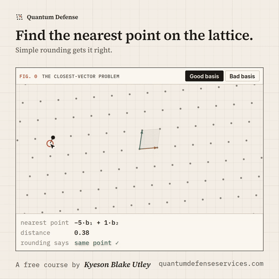

# Quantum Defense

**A free, interactive course on post-quantum cryptography, from first principles to the internals of ML-KEM.**

Created by [Kyeson Blake Utley](https://kyesonutley.com/) · **[quantumdefenseservices.com](https://quantumdefenseservices.com/)**

*The closest-vector problem: with a good basis, rounding finds the nearest lattice point; with a skewed basis for the same lattice, it misses. [Try it live](https://quantumdefenseservices.com/) or [watch the video](https://quantumdefenseservices.com/video/closest-vector-problem/).*

## Why

A large enough quantum computer could break the RSA and elliptic-curve cryptography that secures most internet traffic, and data recorded today can be decrypted later. NIST published the first post-quantum standards (FIPS 203, 204 and 205) in August 2024, and its draft transition plan (NIST IR 8547) proposes disallowing quantum-vulnerable public-key algorithms after 2035. Most material about this is either a press release or a research paper. This course sits in between.

## What's inside

18 lessons in three parts. Start wherever you are.

| Part | For | Lessons |
|---|---|---|
| **I. [Foundations](https://quantumdefenseservices.com/learn/foundations/)** | No math required | What cryptography does · Public-key cryptography · What a quantum computer is (and isn't) · Shor's algorithm · Grover's algorithm · Harvest now, decrypt later |
| **II. [Practitioner](https://quantumdefenseservices.com/learn/practitioner/)** | IT, security, compliance, product | The new NIST standards · Hybrid key exchange in TLS · The deadlines · Cryptographic inventory · Crypto-agility · Certificates, code signing and firmware |
| **III. [Engineer](https://quantumdefenseservices.com/learn/engineer/)** | Math and code | Lattices and Learning With Errors · Inside ML-KEM · Lamport signatures · Winternitz chains and Merkle trees · Implementation pitfalls · Cryptocurrency in a post-quantum world |

Every lesson includes:

- **Interactives that run in your browser** (19 in total): factor a toy RSA key, step through Grover's algorithm, encrypt with a toy LWE scheme, forge a Lamport signature from a reused key, recover a secret from response timing, and check whether your own connection used post-quantum key exchange. All of them are in the [playground](https://quantumdefenseservices.com/playground/).
- **A plain-English summary**, quick checks along the way, and a six-question quiz.
- **Primary sources.** Every date, size and deadline is cited to NIST, the NSA, the UK NCSC, the EU or the IETF.

A [final exam](https://quantumdefenseservices.com/exam/) draws 20 questions from across the course, with a printable certificate of completion.

## Principles

- **Free, no account.** Progress is stored only in your browser.
- **Honest about uncertainty.** Nobody knows when a cryptographically relevant quantum computer will exist; the course gives published estimates with their authors, not predictions.
- **Real cryptography in the demos.** Hash-based demos use real SHA-256 via the Web Crypto API; toy schemes are clearly labeled as toys.

## Corrections

Spotted an error or an outdated fact? [Open an issue](../../issues) or email admin@ghostkey.dev.

## About the author

[Kyeson Blake Utley](https://kyesonutley.com/) is a Texas security engineer and the founder of [GhostKey Development](https://ghostkey.dev/), working on post-quantum migration, cryptocurrency systems and penetration testing.
